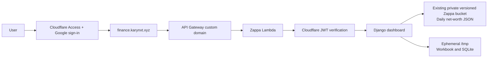

# Deployment Guide

Reviewed against the working tree on **2026-10-31**. These are deployment
procedures, not evidence that the latest changes are live. See
[DOCUMENTATION_UPDATES_SUMMARY.md](DOCUMENTATION_UPDATES_SUMMARY.md) for validation.

## Architecture



Cloudflare Access authorizes one Google identity before forwarding a request. Django then verifies the `Cf-Access-Jwt-Assertion` signature, issuer, audience, expiry, and exact email. This second check denies raw `execute-api` requests that do not contain a valid application token.

## Workbook Schema

Uploaded Excel workbooks must contain these required sheets:

| Sheet | Columns | Purpose |
|-------|---------|---------|
| **MutualFunds** | FundName, Units, Identifier; optional Symbol | Mutual fund holdings and AMFI codes |
| **Retirement** | Type, Amount | EPF, NPS, PF balances |
| **Liquid** | AccountName, Type, Amount | Savings, current accounts |
| **EmergencyFund** | AccountName, Type, Amount, MaturityDate | FD, RD, dedicated reserves |
| **Insurance** | Type, Provider, Premium, Coverage | Term, health, life policies |
| **Metals** | Type, Quantity | Gold/Silver holdings in grams |

Three optional sheets enable advanced analytics:

| Sheet | Columns | Purpose |
|-------|---------|---------|
| **MFTransactions** (optional) | Scheme Name, Transaction Type, Units, NAV, Amount, Date | SIP/lump-sum ledger; drives XIRR and gain analysis |
| **LookThrough** (optional) | Key, Equity, CorporateDebt, GovtSecurities, Cash, Gold, Other, [EquityLarge, EquityMid, EquitySmall, EquityIntl] | Economic look-through overrides per fund or instrument |
| **Targets** (optional) | AssetClass, TargetPct | Target allocation percentages for deviation analysis |

- MFTransactions: `Scheme Name` is matched to `MutualFunds.FundName` and its Identifier is used internally. `Transaction Type` accepts PURCHASE/REDEEM (case-insensitive) and is normalized to Invested/Redeemed. `Amount` is optional and auto-computed as `Units × NAV` if not supplied. Unmatched/ambiguous scheme names and invalid transaction types are skipped with a warning. Legacy `FundIdentifier` + `Type` columns remain supported.
- LookThrough: `Key` is the fund Identifier (mutual funds) or Type (retirement/liquid/EF/metals). Positive bucket/style weights are normalized by the allocation engine. Equity style columns are optional and used only when supplied.
- Targets: `AssetClass` is matched case-insensitively to bucket labels (Equity, Gold, etc.). Percentages are the target allocations; deviations show actual % minus target %.

A workbook without optional sheets is valid. Transaction analytics requires
MFTransactions; allocation uses built-in defaults without overrides. Zero targets
are valid. Numeric text accepts commas/rupee symbols; invalid transaction dates,
types, names, non-finite values, non-positive Units/NAV, or negative Amount rows
are skipped with warnings. Other non-finite portfolio values are rejected.

## Prerequisites

- AWS account and an authenticated local AWS identity for initial Terraform bootstrap.
- Terraform 1.10 or later (required for native S3 state locking).
- Python 3.11.
- Use current dependency pins: Django 5.2.17, PyJWT 2.15.0, certifi 2026.10.18,
  urllib3 2.8.0, and Werkzeug 3.1.9. Native Lambda wheels still use their separate
  requirements file, now pinning cryptography 50.0.0; local Python 3.14 tests are
  not proof of Lambda compatibility.
- Domain registered with its Cloudflare nameservers configured at the registrar.
- GitHub repository Actions enabled.
- Cloudflare API token scoped to `Zone:DNS:Edit` for the dashboard zone.
- Google Cloud service account only if private Sheets are required.

The Terraform backend bucket is not created by this project. Create `finance-dash-tfstate-875636131680` before `terraform init`. Enable bucket versioning, default encryption, block public access, and restrict access to the deployment role. Terraform 1.10 or later uses native S3 lockfiles through `use_lockfile = true`; no DynamoDB lock table is required.

## 1. Phase 0: Bootstrap Terraform and OIDC

An initial trusted AWS identity is required because a GitHub workflow cannot create the IAM role it must already assume. Create the backend bucket, then bootstrap the OIDC provider and deployment role once from an authenticated local environment:

```bash
cd infra
terraform init
terraform apply \
  -target=aws_iam_openid_connect_provider.github \
  -target=aws_iam_role.github_actions_deploy \
  -target=aws_iam_policy.github_actions_deploy \
  -target=aws_iam_role_policy_attachment.github_actions_deploy \
  -var="domain_name=karynxt.xyz" \
  -var="github_owner=praveenkumarv-github" \
  -var="github_repo=portfolio" \
  -var="github_branch=fea-v2"
```

Save `github_actions_role_arn` as the GitHub Actions secret `AWS_GITHUB_ACTIONS_ROLE_ARN`. OIDC trust is restricted to the configured repository and branch. No long-lived AWS key is needed in GitHub.

The CI policy restricts `iam:PassRole` to the application's execution role and
`iam:PassedToService=lambda.amazonaws.com`. Other deployment IAM and S3 actions
remain broad; this is not a complete least-privilege guarantee.

## 2. Optional local Google credentials

For private Sheets in local development, enable Google Drive API, create a service account, and share each Sheet with its `client_email` as Viewer. Set `GOOGLE_SERVICE_ACCOUNT_JSON` locally when needed. Public Sheets do not require a service account.

The deployment patcher removes service-account JSON from Lambda environment
configuration. The current workflow does not provision private Google credentials
for Lambda; private-sheet production access requires a separately secured setup.
Public/private export paths enforce XLSX size limits during download.

## 3. Configure GitHub

Repository secrets:

- `AWS_GITHUB_ACTIONS_ROLE_ARN`
- `DJANGO_SECRET_KEY`: generate at least 32 random bytes.
- `CLOUDFLARE_ACCESS_AUDIENCE`: Access application AUD tag.
- `CLOUDFLARE_ACCESS_ALLOWED_EMAIL`: the single permitted Google email.
- `CLOUDFLARE_API_TOKEN`: token scoped to DNS edit for this zone.

Repository variables:

- `DOMAIN_NAME=karynxt.xyz`
- `SUBDOMAIN=finance`
- `PROJECT_NAME=finance-dash`
- `ENVIRONMENT=prod`
- `ALLOWED_HOSTS=finance.karynxt.xyz,.amazonaws.com`
- `CLOUDFLARE_ACCESS_ENABLED=true`
- `CLOUDFLARE_ACCESS_TEAM_DOMAIN=https://<team-name>.cloudflareaccess.com`
- `CLOUDFLARE_ZONE_ID=<Cloudflare zone ID>`
- `DEPLOY_BRANCH=fea-v2`

Store sensitive identity values as secrets even though the AUD and email are not credentials by themselves.

## 4. Configure Cloudflare Access

Cloudflare Access requires the hostname to be proxied through a Cloudflare-managed zone.

1. Add `karynxt.xyz` to Cloudflare and replace the registrar nameservers with Cloudflare's assigned nameservers.
2. In Zero Trust, add Google as an identity provider. For one user, One-time PIN is also feasible, but Google sign-in provides the preferred account security and MFA controls.
3. Create a self-hosted Access application for `finance.karynxt.xyz`.
4. Create one Allow policy containing only the exact approved email. Do not allow an entire email domain.
5. Copy the Application Audience (AUD) tag to the GitHub secret above.
6. Use a short session duration appropriate for personal use and enable HttpOnly and the binding cookie where browser compatibility permits.

The Phase 2 workflow creates or updates the unproxied ACM validation CNAME and the proxied `finance` CNAME. Keep the validation record permanently for certificate renewal.

## 5. Deploy with two workflows

Run `Phase 1 - Deploy Infrastructure and Lambda` from `fea-v2`. It:

1. Initializes and validates Terraform, then reconciles baseline state in `infra/`.
2. Packages native manylinux dependencies.
3. Patches Zappa settings, including the existing history bucket, and deploys or
  updates `portfolio-production`.
4. Validates that Zappa produced a REST API ID.

After Phase 1 succeeds, run `Phase 2 - Deploy Cloudflare and Domain`. It:

1. Publishes ACM validation CNAMEs to Cloudflare without proxying.
2. Discovers the Zappa REST API from the `portfolio-production` CloudFormation stack.
3. Applies the independent `infra/domain/` Terraform state to validate ACM and create the API Gateway custom domain and mapping.
4. Creates or updates the proxied `finance` CNAME in Cloudflare.

Both workflows are idempotent and share one concurrency group, so they cannot mutate production simultaneously. Run Phase 2 again after certificate or domain configuration changes; normal application-only updates require Phase 1 only.

### Durable net worth history

Run the existing Phase 1 workflow to apply this feature; no new bucket, GitHub
secret, or Phase 2 change is needed. It enables versioning on the existing private
deployment bucket and attaches `${project}-lambda-net-worth-${environment}` to
the Lambda role. Access is limited to listing `net-worth/history/` and reading or
writing objects under that prefix; Lambda receives no history-delete permission.
The existing GitHub deployment role's `s3:*` and IAM create/attach permissions
already cover these changes. The Zappa patcher derives `NET_WORTH_HISTORY_BUCKET`
from the same Terraform `s3_bucket` output used for packaging.

After deploying, load the Google Sheet and click **Update Net Worth**. Check for
`net-worth/history/YYYY-MM-DD.json` in that bucket and reload the dashboard to
confirm the date and value. Reload the sheet first to include new source data.
The save date uses Django's time zone (UTC by default); another save on that day
replaces the current value while S3 retains its earlier version. Records from
other dates survive cold starts and deployments. There is one shared history per
deployment. Demo records are never written to S3.

The cleanup helper refuses to delete a bucket with history records, versions, or
delete markers, and aborts that bucket's cleanup if it cannot inspect them. Do not
expire this prefix or purge its versions. Versioning covers deployment artifacts
as well, so monitor retained storage. Back up the history independently before any
manual bucket teardown. The workbook itself still lives in Lambda `/tmp`; after
a cold start it may need to be loaded again before the chart is displayed.

Production startup fails closed when `DJANGO_SECRET_KEY` is missing. When Cloudflare Access is enabled, startup also requires team domain, AUD, and allowed email.

Production also requires allowed hosts and an explicit Cloudflare enabled/disabled
mode. Keep origin verification enabled for the public deployment. If the optional
history bucket setting is absent, Lambda retains legacy monthly chart behavior
without the durable save control. History errors do not silently fall back.

## 6. Verify

```bash
curl -i https://finance.karynxt.xyz/
curl -i https://<api-id>.execute-api.ap-south-1.amazonaws.com/production/
```

Expected behavior:

- Custom URL redirects unauthenticated browsers to Cloudflare login.
- Only the configured Google account succeeds.
- Raw API Gateway URL returns `403 Access denied` without a valid Access JWT.
- Authenticated Excel upload and public Google Sheet import work; verify private
  imports only if production credentials have been separately configured.
- Update Net Worth persists a date/value after reload, and a same-day lower
  value replaces the current record. Cloud demo actions are denied.
- `http://127.0.0.1:8000` remains available locally without Cloudflare.

A person possessing a still-valid Access application JWT could call the API Gateway URL until token expiry. Signature, audience, issuer, expiry, and exact-email validation substantially constrain this residual risk. Keep Access sessions short and protect the Google account with MFA.

## Updates, rollback, and destroy

Use the deployment workflow for updates. Zappa CLI operational commands are:

```bash
zappa status production
zappa tail production
zappa rollback production -n 1
```

The `Destroy Lambda App` workflow requires the literal confirmation `DESTROY`.
It destroys the independent domain stack, then undeploys Zappa. The foundational
Terraform resources, including the shared history bucket, are retained. The
workflow does not manage Google credential secrets or schedule secret recovery.

Back up the history prefix before any manual bucket teardown. Versioning and
cleanup protection are not substitutes for independent backups.

## Local release checks

These commands do not apply infrastructure or deploy the application:

```bash
python manage.py check
python manage.py makemigrations --check --dry-run
python -m pytest -q
command terraform -chdir=infra init -backend=false -input=false -lockfile=readonly
command terraform -chdir=infra validate
command terraform -chdir=infra fmt -check -recursive
```

Use the real Terraform executable (`command terraform` in Bash) if a local shell
wrapper masks exit status. Run the Ubuntu/Python 3.11 Validate workflow and native
wheel checks before release. Dependency scanning should cover the resolved
release environment as well as explicit requirement pins.
